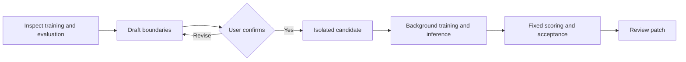

# Model Iteration Skills

Reusable coding-agent skills for researching, reviewing and iterating existing model-training projects, backed by an auditable local experiment runtime.

**English** · [简体中文](README.zh-CN.md)

[](https://github.com/yuanxiang02/model-iteration-skills/actions/workflows/tests.yml)

> **Initial skill bundle + v0.2.0 execution runtime.** Skills provide the agent workflow; `mih` manages isolated experiments and fixed evaluation. Independent end-to-end agent validation is still pending. See [supported platforms and limits](#supported-platforms-and-limits).

## Start with the skills

| Skill | Purpose | Main output |
|---|---|---|
| `$model-iteration` | Route research/review and coordinate the reviewed experiment lifecycle | Runtime handoff and experiment evidence |
| `$mi-research` | Ground implementable approaches in the existing code, papers and repositories | Candidate approaches and falsification experiments |
| `$mi-novelty` | Compare specific contribution claims with closest prior work | Claim-level overlap and search limitations |
| `$mi-review` | Review methodology and integrity with independent agents when authorized | Reviewer traces, findings and disagreements |

These are focused adaptations of selected [ARIS](https://github.com/wanshuiyin/Auto-claude-code-research-in-sleep)
and [autoresearch](https://github.com/uditgoenka/autoresearch) documents. See the
[source map](docs/skill-sources.md), [unchanged snapshots](third_party/README.md)
and [MIT notices](skills/model-iteration/references/attribution.md).

### Install in Codex

```bash
git clone https://github.com/yuanxiang02/model-iteration-skills.git
cd model-iteration-skills
python3 scripts/install_skills.py
```

This copies all four skills together to `$CODEX_HOME/skills`, or `~/.codex/skills`
when unset. It refuses to overwrite an existing skill. Use `--dest /path/to/skills`
for another installation location. It does not install upstream snapshots, the
Python runtime or external tools. Refresh the host's skill list/start a new session
as needed, then ask:

```text
Use $mi-research to inspect my current training project and propose cheap ways
to reduce development NLL. Research only; do not start training.

Use $mi-novelty to check the selected mechanism against the closest prior work.

Use $mi-review with two independent agents to review methodology and integrity.
Save both raw reviews and preserve disagreements; do not start training.

Use $model-iteration to prepare a concrete boundary specification for this project.
After I confirm it, run one experiment within the agreed budget.
```

Research and review use tools supplied by the host; no fixed model/provider is
required. Multi-agent review requires authorization and available subagent tools.
Missing search/review capability is reported rather than fabricated. Novelty
assessment is optional for ordinary engineering improvements.

### Standard stage interface

Each stage uses **`request.json → result.json + hashed evidence`** outside the
model repository. Natural-language requests are normalized to this interface.
The [v1 protocol](skills/model-iteration/references/protocol.md) defines stages,
statuses, decisions, payloads and reviewer records. For example:

```bash
python3 skills/model-iteration/scripts/packet.py init /tmp/mi-research-01 \
  --stage research --repository /absolute/path/to/model-repo \
  --goal "Reduce development NLL within the current architecture"
python3 skills/model-iteration/scripts/packet.py check /tmp/mi-research-01 --request-only
# After the agent writes result.json and its evidence:
python3 skills/model-iteration/scripts/packet.py check /tmp/mi-research-01
```

Use a fresh directory for each request/revision. Checks validate structure, hashes
and basic review completeness; they do not certify novelty, reviewer identity or
model gains. The first bundle does not automatically dispatch agents, chain stages,
or turn review packets into an enforced runtime promotion gate.

## What it does

Coding agents can change training code, but a useful experiment also needs a stable evaluator, attributable outputs, recoverable execution, and an explicit acceptance decision.

The execution runtime manages that experiment lifecycle around your existing training program:

- Keep baseline and candidate code in separate Git worktrees.
- Review editable paths, protected paths, data/scoring references, seeds, and budgets before project iteration.
- Run training and optional checkpoint inference in detached local workers.
- Calculate scores with a frozen evaluator instead of trusting training stdout.
- Preserve patches, logs, artifacts, failures, and accepted/rejected/inconclusive decisions.
- Apply a candidate patch only through a separate explicit promotion action.

The core does not implement a new trainer or require an LLM API key. Codex or another coding agent can call it through a shell tool, following the bundled skills. A built-in model API client and automatic agent wakeups are not implemented.

## Three-stage workflow

| Stage | Commands | Result |
|---|---|---|
| **1. Assess decoupling** | `mih project inspect` | Entry-point observations and a separation plan; no automatic rewrite or proof of evaluator independence |
| **2. Review boundaries** | `mih project draft`, `compare-split`, `approve` | Versioned `spec.json`, readable `BOUNDARIES.md`, and explicit operator acknowledgment of the exact specification |
| **3. Iterate** | `mih iterate`, `submit`, `report`, `promote` | Independent experiments bound to the approved protocol |



An awaiting or changed review blocks iteration for a registered project in the same state root. The agent must not approve its own specification on the user's behalf.

## Install the experiment runtime

Requirements: Git, a POSIX system, and Python 3.9+. Python 3.10+ is recommended for the example suite because the pinned SimpleBayes library requires it. PyTorch is optional and must already be installed for the language-model example.

```bash
git clone https://github.com/yuanxiang02/model-iteration-skills.git
cd model-iteration-skills
python3 -m venv .venv
source .venv/bin/activate
python -m pip install -e .
mih --version
mih --help
```

The core has no third-party runtime dependencies. Install from this repository; the commands above do not assume a PyPI release. Subsequent commands assume this checkout is the current directory and the virtual environment is active.

## Try a lightweight experiment

```bash
# Scalar neural-network training: standard library + pinned micrograd source.
python examples/run_lightweight.py --task micrograd

# Tiny text classification; run this driver with Python 3.10+.
python examples/run_lightweight.py --task simplebayes

# CPU-only text GRU: training -> checkpoint inference -> independent scoring.
python examples/run_lightweight.py --task torch-lm
```

These are manual smoke runs through the low-level runner. They demonstrate the experiment lifecycle; they do not replace the reviewed project workflow below.

The preparation script downloads a few source/license files pinned by commit and SHA-256. It uses tiny constructed data, retains results under `.mih-demo/`, and never downloads PyTorch, provisions compute, or calls a model API.

On Linux, explicitly add `--isolation trusted-local` for trusted examples. `auto` selects the macOS subprocess sandbox on macOS and fails on platforms without that backend.

The PyTorch example probes existing interpreters. To choose one explicitly:

```bash
python examples/run_lightweight.py --task torch-lm \
  --torch-python /path/to/python-with-torch \
  --torch-python-path /path/to/its/site-packages
```

On the recorded Mac, micrograd and text classification took a few seconds each. A user-approved PyTorch round used **568 parameters, one CPU thread, five paired seeds, about 44 seconds, and 271 MiB peak child RSS**. Most of that memory is framework overhead, not model weights. These are observations, not performance guarantees; see [validation records](docs/validation/README.md).

## Walk through a reviewed project

This example prepares micrograd without starting training. Keep the harness state outside the training repository; the following layout does that automatically.

```bash
python examples/run_lightweight.py --task micrograd \
  --root .mih-demo-reviewed --prepare-only

mih --state .mih-demo-reviewed/state project inspect \
  .mih-demo-reviewed/projects/micrograd \
  --train train.py --eval "$PWD/src/mih/scoring.py"
```

Commands return JSON. In the examples below, replace `PROJECT_ID`, `SPEC_DIGEST`, and `EXP_ID` with the values returned by your commands. `CANDIDATE_WORKSPACE` means the returned candidate path; these names are placeholders.

Use a fresh `--root` when repeating this walkthrough, or explicitly use `project inspect --refresh` to reassess an existing project. Refresh preserves history and invalidates its previous approval.

### 1. Inspect the separation plan

Read the generated `DECOUPLING.md` and `analysis` output. Findings are `split-required`, `separate-entrypoints`, or `uncertain`.

Shared training/scoring code may need a frozen scoring entry and checkpoint/inference or prediction-export interfaces. Preserve the original training behavior and checkpoint-selection policy during this refactor. Static inspection does not establish data flow or full behavioral equivalence.

### 2. Draft and confirm the boundaries

```bash
mih --state .mih-demo-reviewed/state project draft PROJECT_ID \
  .mih-demo-reviewed/micrograd-contract.json \
  --protect vendor/ --protect upstream.json

mih --state .mih-demo-reviewed/state project status PROJECT_ID
```

Open the returned `boundaries` and `specification` paths. Review allowed/protected files, fixed evaluation inputs and reference data, scorer, environment, budgets, seeds, and acceptance policy with the user. Explicit deny paths take precedence over allowed directories.

If the assessment requires a split, compare before/after exports on the same inputs before approval:

```bash
mih --state .mih-demo-reviewed/state project compare-split PROJECT_ID \
  --before /path/to/original-predictions.jsonl \
  --after /path/to/separated-predictions.jsonl
```

Only after the user acknowledges the exact specification should an operator record approval:

```bash
mih --state .mih-demo-reviewed/state project approve PROJECT_ID \
  --digest SPEC_DIGEST --reviewer "your-name"
```

The agent must not self-approve. The reviewer field is a local attestation, not authenticated human identity. Export comparison checks the supplied records, not their execution provenance or the whole training pipeline.

### 3. Make one candidate and run it

```bash
mih --state .mih-demo-reviewed/state iterate PROJECT_ID \
  --hypothesis "Increase SGD steps from 1 to 40 with the same model and data"
```

In **`CANDIDATE_WORKSPACE/settings.json`**, change `{"steps": 1}` to `{"steps": 40}`. Edit the returned candidate, not the original project. You can also supply a patch through `iterate --patch /path/to/change.patch`.

```bash
mih --state .mih-demo-reviewed/state submit EXP_ID
mih --state .mih-demo-reviewed/state status EXP_ID
mih --state .mih-demo-reviewed/state wait EXP_ID --timeout 60
mih --state .mih-demo-reviewed/state report EXP_ID
```

`submit` starts a detached worker and returns. The worker continues after the agent turn ends. `wait` is ordinary Python waiting and makes no model calls; it may return a nonterminal report when its waiting timeout expires. `status` is compact; `report` includes detailed evidence.

A longer training run is not guaranteed to produce an accepted candidate. Inspect `accepted`, `rejected`, or `inconclusive` honestly. If accepted, check the promotion artifact:

```bash
mih --state .mih-demo-reviewed/state promote EXP_ID
```

To explicitly apply it after review:

```bash
mih --state .mih-demo-reviewed/state promote EXP_ID --apply
```

This updates the **original training repository as uncommitted changes**. It does not commit, push, or merge anything. The destination must still be clean and match the evaluated baseline. Changing the committed baseline or the frozen protocol requires a new specification/review in this prototype.

## Connect an existing training framework

Keep your PyTorch, Lightning, Trainer, or custom training loop. Describe its commands and artifact interfaces. A thin wrapper may be needed to export predictions or adapt your existing evaluation entry.

The following is a valid v1 contract shape. Replace paths and flags to match your actual scripts; it is not a ready-to-run configuration for an arbitrary repository.

```json
{
  "schema_version": 1,
  "hypothesis": "One declared model change improves the fixed development metric.",
  "source": {
    "repository": "/path/to/training-repository",
    "baseline": "HEAD",
    "allowed_paths": ["model/", "train.py", "config/"],
    "protected_paths": ["eval.py", "metrics/"]
  },
  "training": {
    "argv": ["/path/to/python", "train.py", "--output-dir", "{output}", "--seed", "{seed}"],
    "inference_argv": ["/path/to/python", "integration/export_predictions.py", "--checkpoint", "{output}/checkpoint.pt", "--inputs", "{inputs}", "--output", "{predictions}"],
    "inputs": "/path/to/evaluation-inputs.jsonl"
  },
  "evaluation": {
    "reference": "/path/to/reference.jsonl",
    "metric": "accuracy",
    "direction": "maximize"
  },
  "execution": {"isolation": "auto", "timeout_seconds": 20},
  "acceptance": {
    "scope": "development",
    "seeds": [11, 22, 33, 44, 55],
    "confidence": 0.95,
    "minimum_effect": 0.0,
    "bootstrap_samples": 2000
  }
}
```

`training.inputs` currently names the prediction/evaluation input file, not the entire training dataset. Your original training program still handles its own training data. Reference labels must be outside the candidate source repository. Output checkpoints, logs, and predictions belong in `{output}`, not the source worktree.

The default scorer supports accuracy and next-token NLL, using JSONL rows with exact matching IDs. A custom `evaluation.evaluator` must be a trusted standalone Python script accepting `--predictions`, `--reference`, `--metric`, and `--output`. It runs in the harness Python environment with isolated imports; install any trusted scoring dependencies there. Training can use its own interpreter and explicitly declared `training.python_paths`.

Scopes are file/directory prefixes, not glob patterns. Commands are argv arrays, not shell strings. See [the runtime contract](docs/runtime.md#working-contract-v1) for placeholders, prediction format, budgets, and custom evaluators.

## Use it from a coding agent

Give the agent the project ID, state root, and [operating guide](docs/agent-workflow.md). A suitable task is:

> Inspect this project through the harness. Propose any required training/scoring separation, then draft boundaries for my review. Do not approve on my behalf. After approval, create one candidate for one hypothesis, edit only allowed paths, submit once, and review the recorded result. End the model turn while training runs. Do not change the evaluator or apply a promotion without authorization.

The agent uses the same JSON CLI as a human or script. Keeping job state in files allows another agent session to reconnect without relying on conversation memory.

## Inspect evidence and recover

| Command | Purpose |
|---|---|
| `mih validate contract.json` | Validate and resolve a contract without starting training |
| `mih --state STATE list` | List experiment states |
| `mih --state STATE status EXP_ID` | Read compact current status |
| `mih --state STATE report EXP_ID` | Read observations, logs/artifact references, and acceptance |
| `mih --state STATE recover EXP_ID` | Reconcile a recorded worker/job; recover a queued launch intent |
| `mih --state STATE cancel EXP_ID` | Request cancellation |

A lost worker with a still-live recorded child becomes `orphaned`; the harness does not silently start duplicate training. Interrupted experiments are not automatically retried.

```text
STATE/
  projects/PROJECT_ID/      # analysis, specification revisions, approval records
  runs/EXP_ID/              # frozen contract/scorer, patch, logs, scores, acceptance
  workspaces/EXP_ID/        # baseline and candidate source
  outputs/EXP_ID/           # checkpoints and predictions, grouped by role and seed
```

Failed and inconclusive runs stay in the archive. Cleanup, checkpoints, and local datasets are not pushed by the harness.

## Supported platforms and limits

| Area | Current support |
|---|---|
| macOS | Local detached jobs with `sandbox-exec` restrictions on candidate subprocesses |
| Linux | Explicit `trusted-local` mode for trusted code; no enforced Linux sandbox yet |
| Windows | Not supported |
| Training | Existing local commands, optional separate inference, small artifact/prediction interfaces |
| Acceptance | Development-only paired-seed percentile bootstrap |
| Agent integration | JSON CLI through existing shell tools |

The calling agent is not automatically sandboxed. Same-user unrestricted access or a different state root is outside the approval gate's authority. The macOS backend does not hide every host file and is not a production security guarantee.

The prototype has small-example file/budget limits and does not provide full dependency snapshots, remote/Slurm execution, arbitrary experiment ancestry, automatic baseline ratcheting, automatic agent callbacks, or a GUI/MCP server. It does not yet provide general non-inferiority or multi-objective acceptance policies.

Current caps: each prediction-input, reference, or evaluator file is at most 10 MiB; the monitored output budget defaults to 10 MiB and can be configured up to 100 MiB; command timeouts range from 1 to 3,600 seconds. These controls are not a strict aggregate memory/compute limit. Larger training projects need further backend/artifact support.

Development bootstrap intervals do not solve small-sample calibration, adaptive selection, repeated testing, or evaluation-sample uncertainty. An accepted development experiment is not a confirmed generalization gain. See [the detailed boundaries](docs/runtime.md#statistical-boundary).

## Validation and development

```bash
python -m unittest discover -s tests -v
```

The suite contains **42 behavior tests**. CI runs on Linux/Python 3.9 and 3.12 and macOS/Python 3.12. Tests cover source/evaluator protection, prediction validity, timeouts/cancellation, recovery, reviewed project gates, policy drift, explicit promotion, skill installation and packet/evidence checks. Fixture approvals and reviewer identities are simulated and clearly labeled; these are not end-to-end LLM behavior tests.

- [Model smoke results](docs/validation/README.md)
- [Three-stage workflow checks](docs/validation/project-workflow.md)
- [Runtime and contract reference](docs/runtime.md)
- [Project onboarding guide](docs/project-workflow.md)
- [Architecture](docs/architecture.md) · [MVP](docs/mvp.md) · [Contributing](CONTRIBUTING.md)

The design draws on established experiment-management ideas in [autoresearch](https://github.com/karpathy/autoresearch), [DVC Experiments](https://dvc.org/doc/user-guide/experiment-management), and [ShinkaEvolve](https://github.com/SakanaAI/ShinkaEvolve). This repository focuses on the boundary between an existing trainer, a coding agent, fixed scoring, and reviewed promotion.

## License

[MIT](LICENSE). Downloaded example sources retain their upstream licenses; dependency/license references are pinned in [examples/upstreams.json](examples/upstreams.json).
